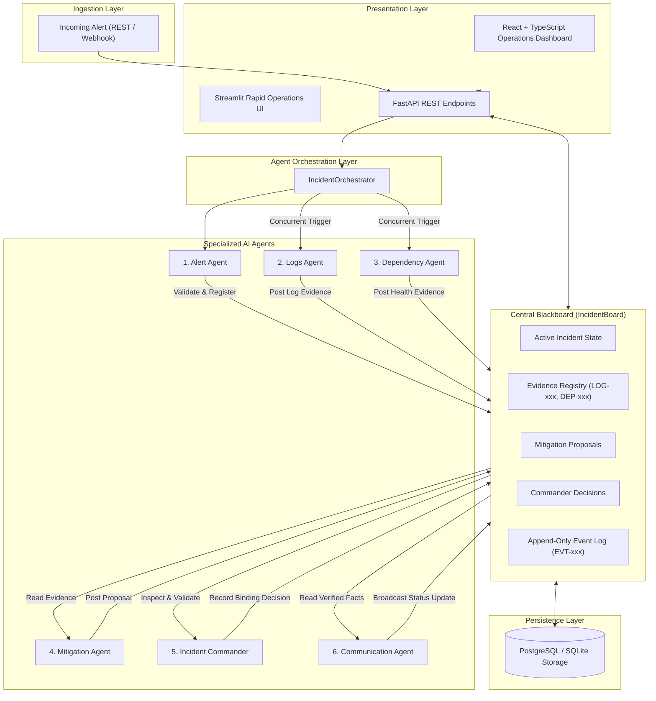
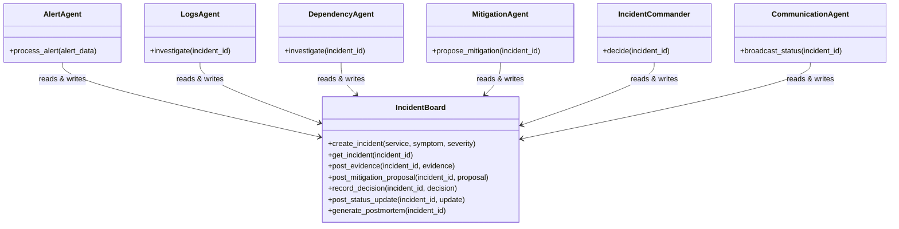
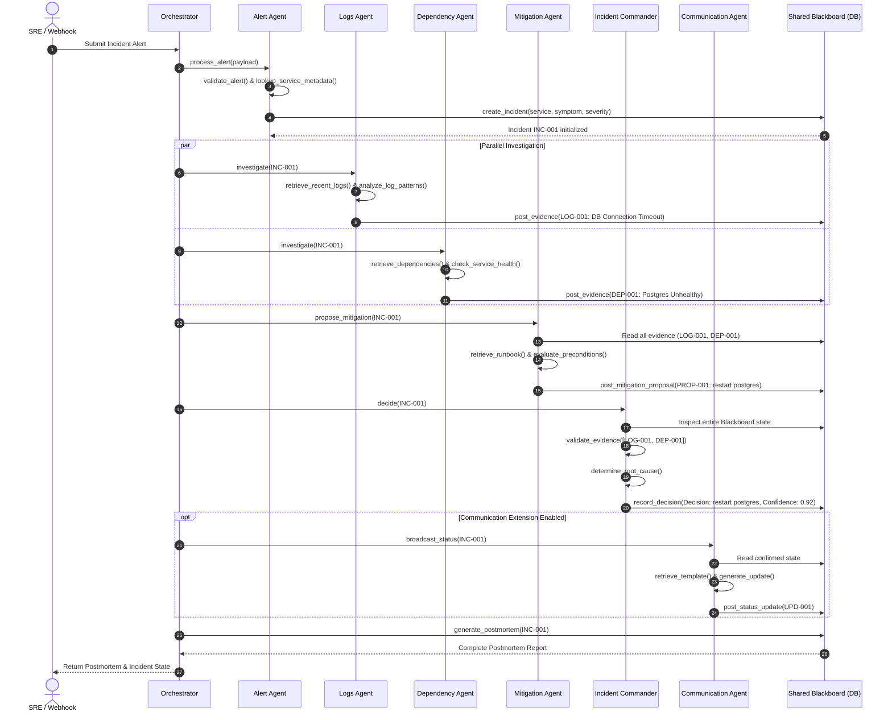

# Layer 2: System Architecture Document
## AI IncidentOps: Multi-Agent IT Incident Response War-Room

---

## 1. High-Level Architecture Overview

The system implements the **Blackboard Architectural Pattern**. Rather than agents passing ad-hoc messages directly to one another in a point-to-point fashion, all agents read from and write to a single source of truth: the **Shared Incident Board**.

---

## 2. Low-Level Component Architecture

### 2.1 The Shared Blackboard (`core/incident_board.py`)
The Blackboard encapsulates all incident state modifications:
- **Thread Safety**: Inter-process and intra-process concurrency protection via `threading.Lock` and ACID database transactions.
- **Append-Only Event Log (`core/event_logger.py`)**: Every agent invocation, evidence registration, status change, and decision appends an immutable `TimelineEvent` record with an auto-incrementing monotonic sequence.
- **Data Integrity**: State cannot be mutated arbitrarily; transitions follow the lifecycle:
  $$\text{INVESTIGATING} \longrightarrow \text{MITIGATING} \longrightarrow \text{MITIGATED / RESOLVED}$$
  $$\text{INVESTIGATING} \longrightarrow \text{ESCALATED}$$

### 2.2 Agent Module Boundaries & Tool Contracts

Each agent operates inside its own module and executes tools through **Microsoft Semantic Kernel / Agent Framework**:

---

## 3. Orchestration Sequence Diagram

---

## 4. Architectural Invariants & Safety Guarantees

1. **Strict Evidence Grounding**: The Incident Commander's root cause must reference valid `evidence_id` tokens previously recorded on the Blackboard. Hallucinated IDs are caught by `validate_evidence()`.
2. **Recommendation-Only Default**: Automated destructive actions (container deletion, DB restart, deployment rollback) are never triggered without human approval.
3. **Safe Escalation**: When evidence is missing or ambiguous (Scenario D), the system issues a `hold_and_escalate` decision rather than guessing.
4. **Append-Only Auditing**: Every state change produces an immutable event log record with ISO-8601 timestamp and monotonic sequence.
