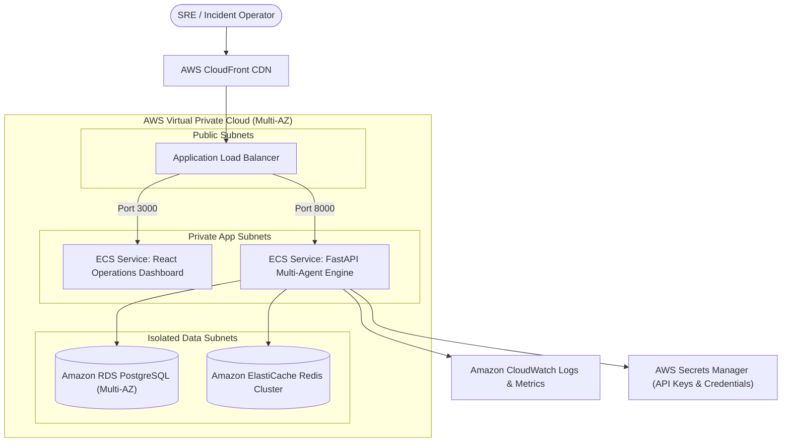

# Layer 7: Cloud Infrastructure & Deployment Architecture

## 1. Cloud Target: AWS Elastic Container Service (ECS)

In production enterprise environments, **AI IncidentOps** is deployed as containerized services orchestrated via AWS ECS Fargate, providing high availability, auto-scaling, and isolation without EC2 server maintenance overhead.

## 2. Infrastructure Services Specification
- **AWS ECS (Fargate)**: Serverless task execution for the FastAPI backend and React frontend.
- **Amazon RDS for PostgreSQL (Multi-AZ)**: Managed relational persistence with automated daily snapshots and point-in-time recovery.
- **Amazon ElastiCache for Redis**: In-memory caching for topology registries and runbook catalogs.
- **AWS Secrets Manager**: Secure management of model credentials (`OPENAI_API_KEY`) and JWT secrets (`JWT_SECRET`).
- **Amazon CloudWatch**: Centralized log streaming and alerting alarms for API latencies $> 2000\text{ms}$.

## 3. Cost Considerations & Auto-Scaling Policy
- Minimum 2 tasks across distinct Availability Zones for high availability.
- Scale-out trigger: CPU utilization $> 75\%$ or request count per target $> 1000\text{ req/min}$.
