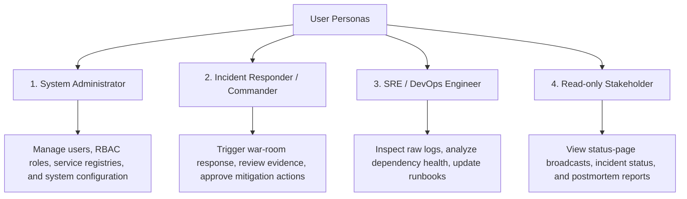

# Layer 1: System Design Document
## AI IncidentOps: Autonomous Multi-Agent IT Incident Response War-Room

---

## 1. Product Requirements Document (PRD)

### 1.1 Problem Statement & Background
1
**AI IncidentOps** automates this investigation and decision-support workflow using a multi-agent war-room coordinated through the **Blackboard Architecture**. Specialized AI agents collaborate asynchronously:
1. Validating incoming alerts against service registries.
2. Collecting real application and system logs and extracting error signatures.
3. Probing upstream and downstream dependency health endpoints.
4. Synthesizing findings against predefined operational runbooks to formulate mitigation proposals.
5. Convening the **Incident Commander** to strictly cross-validate posted evidence, determine the probable root cause, calculate confidence, and make binding mitigation recommendations.
6. Generating real-time stakeholder status-page broadcasts without false recovery claims.
7. Compiling an immutable chronological event timeline and postmortem report.

---

## 2. Functional Requirements

| ID | Capability | Description |
|---|---|---|
| **FR-01** | **Incident Ingestion** | Accept structured JSON alert payloads via REST endpoint (`POST /api/v1/incidents/alert` or `POST /api/v1/incidents`). |
| **FR-02** | **Alert Validation & Enrichment** | Validate required schema fields (`service`, `symptom`, `severity`, `timestamp`), normalize severity levels (`critical`, `high`, `medium`, `low`), and look up owner/tier metadata from service registry. |
| **FR-03** | **Log Investigation** | Retrieve recent log lines from disk/container for the affected service, parse deterministic error patterns (e.g., regex for DB timeouts, stack traces, CPU alerts), and post evidence items with source references to the Blackboard. |
| **FR-04** | **Dependency Investigation** | Traverse upstream and downstream topology from service registry, execute live HTTP health checks or simulated runtime probes, and post dependency status evidence. |
| **FR-05** | **Mitigation Analysis** | Query recovery runbook repository based on dominant log pattern and symptoms, evaluate action preconditions against system evidence, and post mitigation proposals with risk levels (`low`, `medium`, `high`). |
| **FR-06** | **Evidence Cross-Validation** | Incident Commander cross-checks every cited evidence ID against actual Blackboard records before deciding root cause. Rejects non-existent or fabricated evidence. |
| **FR-07** | **Commander Decision Authority** | Determine probable root cause, select mitigation action, calculate confidence score, and flag escalation requirement. Never execute destructive actions automatically without explicit human operator approval. |
| **FR-08** | **Chronological Timeline** | Record every agent action, evidence post, proposal, status update, and decision in an append-only event log. |
| **FR-09** | **Postmortem Generation** | Assemble a comprehensive Markdown and JSON postmortem report containing incident summary, root cause, supporting citations, logs findings, dependency findings, timeline, and mitigation decisions. |
| **FR-10** | **Stakeholder Communication** | Generate severity- and lifecycle-specific status-page updates. Never declare an incident "resolved" unless actual service recovery is verified. |
| **FR-11** | **State Retrieval** | Expose REST endpoints and UI viewers for historical incidents, event logs, and active war-room state. |

---

## 3. Non-Functional Requirements (NFR)

- **Reliability & Determinism**: System must execute reliably in both local mock mode (100% deterministic test execution without paid API keys) and LLM-assisted interpretation mode.
- **Data Consistency & Concurrency**: The shared Blackboard must support concurrent writes from parallel investigative agents without state corruption using transactional operations and locks.
- **Maintainability & Modularity**: Each agent must exist in its own separate Python module (`agents/*.py`) and interact with discrete Python tools (`tools/*.py`).
- **Observability**: Structured JSON logging, OpenTelemetry tracing, and Prometheus metrics for agent execution durations, error rates, and active incidents.
- **Security & Safety**: Role-Based Access Control (RBAC), strict input validation, tool execution sandboxing (no arbitrary shell execution by LLMs), and recommendation-only mitigation mode.
- **Auditability**: The event log must be strictly append-only; historical evidence and decisions cannot be silently deleted or overwritten.

---

## 4. User Personas

1. **System Administrator**: Responsible for platform configuration, registering new microservices, managing RBAC policies, and monitoring overall system health.
2. **Incident Responder / Commander**: Leads active triage, reviews agent-proposed recovery procedures, approves controlled mitigation execution, and resolves incidents.
3. **SRE / DevOps Engineer**: Deep-dives into telemetry, verifies root-cause evidence IDs, audits runbook matching, and incorporates postmortem recommendations.
4. **Read-only Stakeholder**: Product managers and executives who require real-time status-page headlines, business impact assessments, and postmortem summaries.

---

## 5. Main Operational Workflows

### Workflow 1: Incident Ingestion & Validation
Alert received via webhook/API $\rightarrow$ Alert Agent validates payload $\rightarrow$ Queries service registry $\rightarrow$ Creates incident record on Blackboard $\rightarrow$ Logs `incident_created` event.

### Workflow 2: Parallel Investigation
Orchestrator spawns `Logs Agent` and `Dependency Agent` concurrently $\rightarrow$ Logs Agent parses recent application logs and extracts pattern signatures $\rightarrow$ Dependency Agent checks health probes for upstream/downstream nodes $\rightarrow$ Both post structured `EvidenceItem` records to Blackboard with unique IDs (`LOG-001`, `DEP-001`).

### Workflow 3: Mitigation Formulation
Mitigation Agent reads all posted evidence $\rightarrow$ Searches `infrastructure/runbooks/` for matching remediation procedures $\rightarrow$ Evaluates preconditions and risk $\rightarrow$ Posts `MitigationProposal` to Blackboard.

### Workflow 4: Decision & Governance
Incident Commander inspects entire Blackboard $\rightarrow$ Validates cited evidence IDs $\rightarrow$ Evaluates root cause $\rightarrow$ If evidence is sufficient: records decision with recommended action and confidence score; if evidence is insufficient: halts automated mitigation, records `insufficient_evidence`, and sets `escalation_required = true`.

### Workflow 5: Stakeholder Broadcast
Communication Agent retrieves template based on severity and status $\rightarrow$ Formats public status-page announcement grounded in confirmed facts $\rightarrow$ Posts `StatusUpdate` to Blackboard.

### Workflow 6: Postmortem & Audit
Blackboard compiles all evidence, proposals, decisions, and timeline events into a structured `PostmortemReport` exportable in Markdown or JSON.

---

## 6. Failure Scenarios Matrix

| Scenario | Symptom / Injected State | Expected Agent Behavior | Commander Decision | Safety Invariant |
|---|---|---|---|---|
| **Scenario A: Database Failure** | PostgreSQL container down; Payment API logging `psycopg2.OperationalError` | Logs Agent cites connection timeouts; Dependency Agent reports `postgres: unhealthy` | Root Cause: Database connectivity failure; Mitigation: `restart` on `postgres` (Confidence > 0.85) | Database restarted only upon human confirmation |
| **Scenario B: Failed Deployment** | Release v2.4.1 deployed; syntax error / `AttributeError` in logs; DB healthy | Logs Agent flags post-release exception; Dependency Agent reports all services healthy | Root Cause: Post-deployment regression; Mitigation: `rollback` to v2.4.0 on `payment-api` | Rollback proposed only when dependencies are confirmed healthy |
| **Scenario C: High CPU Saturation** | Worker nodes at 98% CPU; queue depth saturated; HTTP 504 timeouts | Logs Agent flags thread exhaustion; Dependency Agent reports high latency | Root Cause: Worker thread saturation; Mitigation: `restart` on `payment-api` | Clears runaway worker threads |
| **Scenario D: Insufficient Evidence** | Customer reports transient slowness; logs clean; all services healthy | Logs Agent detects 0 errors; Dependency Agent reports 100% healthy | Root Cause: Insufficient evidence; Mitigation: `hold_and_escalate` (Confidence < 0.50) | **NO false root cause hallucinated; safe escalation** |
| **Scenario E: Agent Execution Failure** | Tool network timeout or log file corrupted | Agent logs error event; Orchestrator captures exception without crashing | Commander identifies missing agent findings; records degraded confidence or escalates | Graceful degradation; partial evidence preserved |

---

## 7. Technical Risk Assessment

| Risk | Impact | Likelihood | Mitigation Strategy |
|---|---|---|---|
| **LLM Evidence Hallucination** | High | Medium | All evidence items must be produced by deterministic Python tools with concrete file/line/probe sources. Commander strictly verifies cited IDs exist in Blackboard database. |
| **Concurrent Write Corruption** | High | Low | Thread locks and SQLite/PostgreSQL transactional writes with atomic increments for sequence numbers. |
| **Destructive Mitigation Execution** | Critical | Low | System operates in recommendation-only mode by default. Mitigation execution requires explicit human operator confirmation. |
| **Stale Cache Signals** | Medium | Medium | Health checks probe live endpoints or state files; Redis caching is restricted to static service registries and runbooks with short TTL. |
